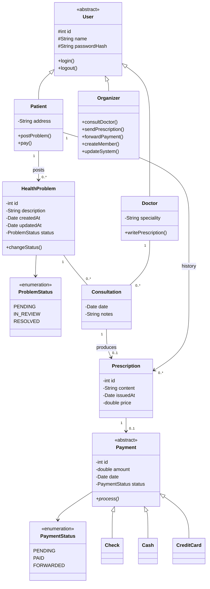
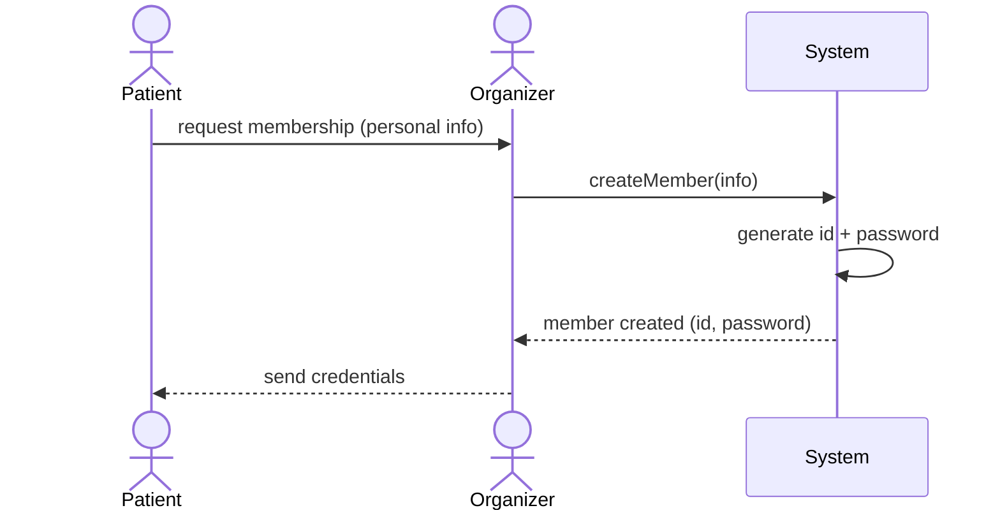
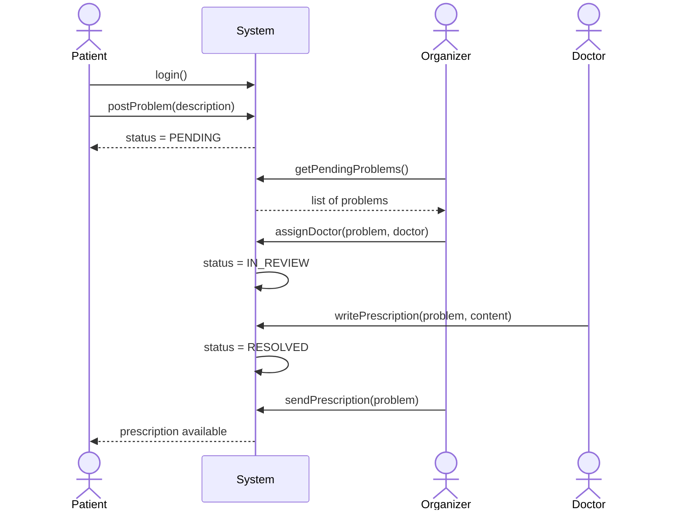
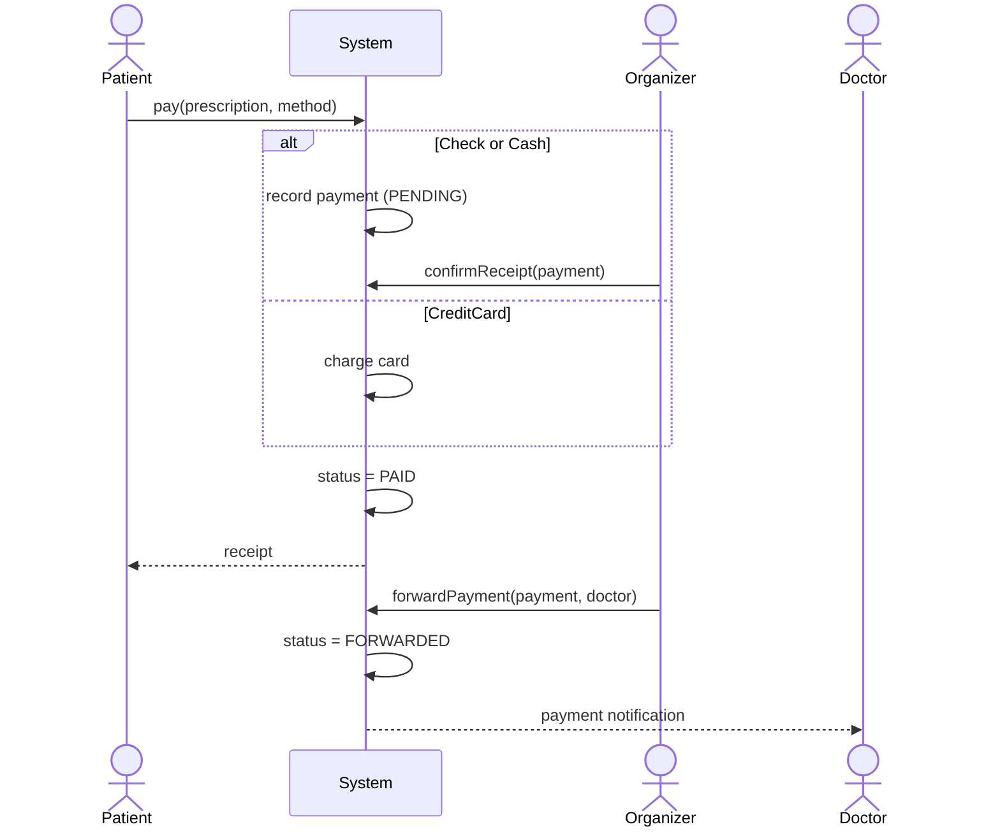
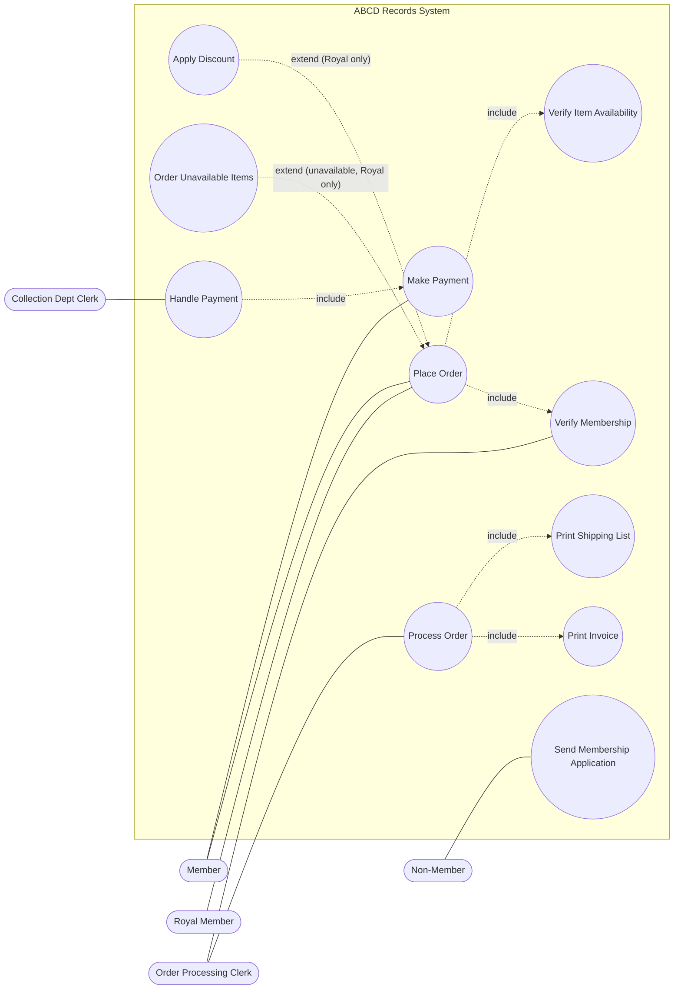
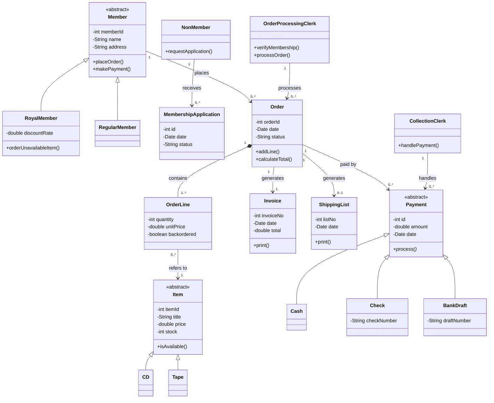
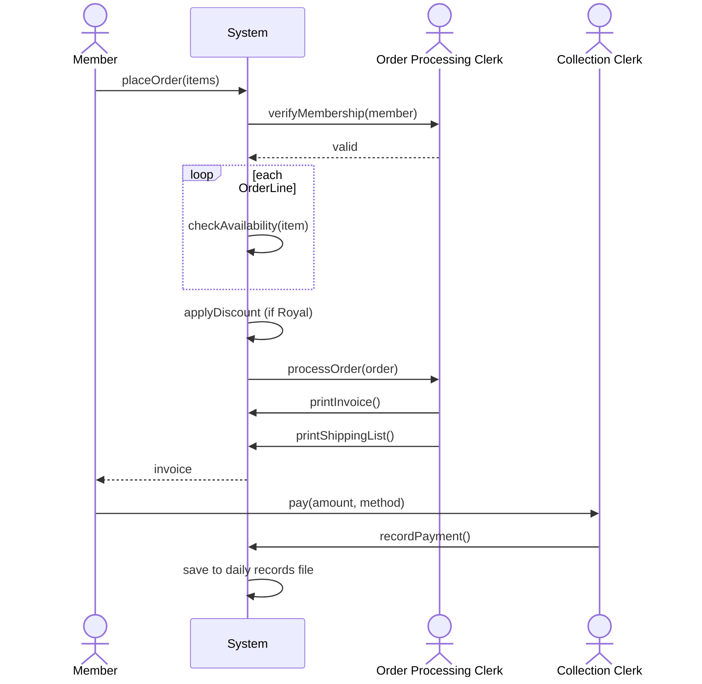
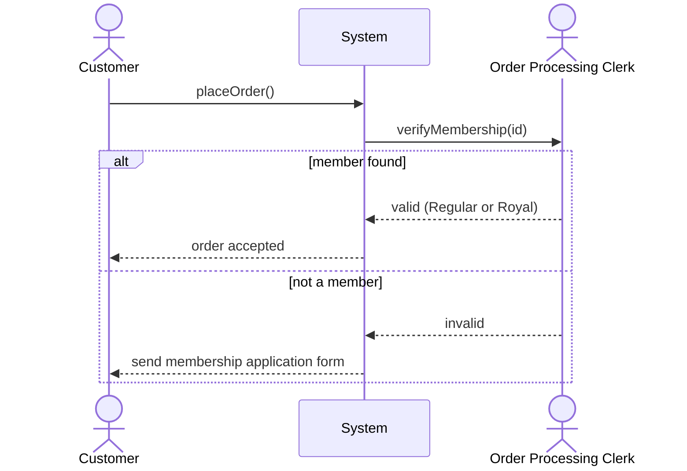
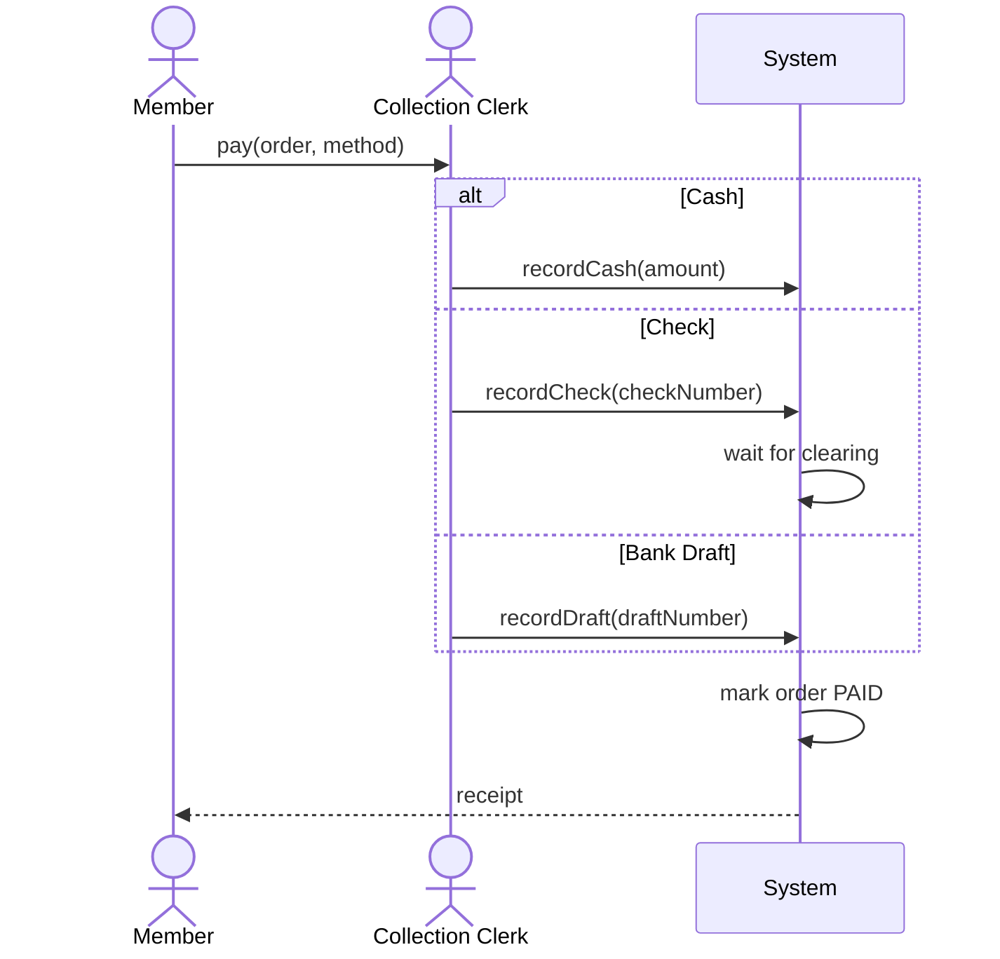
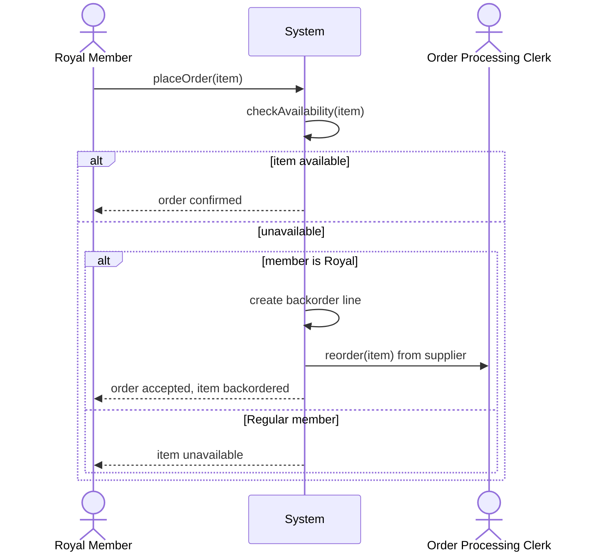

# UML - Final Versions

---

# Exo 1 - Hospital Management System

## Class diagram

## SSD 1 - Patient registration

## SSD 2 - Consultation flow

## SSD 3 - Payment processing

---

# Exo 2 - ABCD Records

## Use case diagram

## Class diagram

## Sequence 1 - Complete order processing

## Sequence 2 - Membership verification

## Sequence 3 - Payment processing

## Sequence 4 - Item reordering for Royal members

